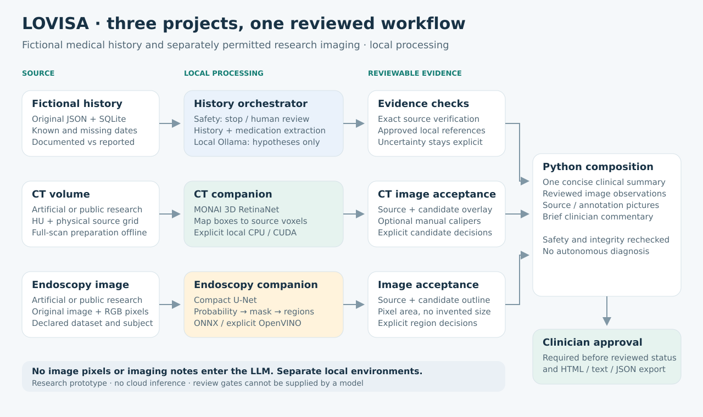

# LOVISA

**Medical History & Clinical Reasoning Assistant**

A locally deployed research application that organizes **fictional patient
histories**, proposes source-grounded hypotheses and combines accepted CT and
endoscopy observations into a short report for clinician review.



## Three projects, clear responsibilities

| Project | Input → output |
| --- | --- |
| **LOVISA** — this repository | Synthetic JSON + accepted imaging → safety-gated, concise clinical summary |
| [Lung CT assistant](https://github.com/LilyC2024/ai-medimg-2.5D-CT) | Supported CT volume → candidates, source annotations and optional manual calipers |
| [Endoscopy assistant](https://github.com/LilyC2024/AI-MedImg-Endo) | Permitted research JPG/PNG → candidate regions, mask and pixel-area observations |

Each project has its own local environment. Image evidence never becomes a
confirmed diagnosis. Public images are allowed only in labelled fictional
composite cases with provenance; unrelated source subjects stay separate.

## Run locally

Use Python 3.10+ and local Ollama with **`gemma4:e2b`**. Reuse an existing `.venv`;
for a fresh Linux checkout:

```bash
git clone https://github.com/LilyC2024/Medical-AI.git
cd Medical-AI
python3 -m venv .venv
.venv/bin/python -m pip install -r requirements.lock.txt
.venv/bin/python -m medical_assistant.auth
.venv/bin/python -m streamlit run app.py
```

Open [localhost:8501](http://127.0.0.1:8501), sign in and choose one patient.
[Complete setup](docs/SETUP.md) covers Ollama, Windows, companion discovery and
explicit local-demo account creation. No account/password is bundled in source.

## Use the workspace

1. Read **Patient overview** and original sources; only the selected case appears.
2. Optionally **Upload → Analyze** in CT or Endoscopy review. ZIPs open included
   results; permitted research-kit endoscopy JPG/PNG files run the installed model.
3. Inspect candidates and explicitly include or discard each pending study.
4. Complete **Safety check**, then **Generate draft for clinician review**.
5. Read the short summary/images, optionally preview a clinician note, and
   explicitly approve before a reviewed report can be exported.

The right-hand guide links directly to actions. Errors are visible and retryable.
Adding images after report preparation starts a fresh unreviewed context and
requires safety again; saved reports remain unchanged. [Detailed workflow](docs/WORKFLOWS.md).

## Agents and models

One LangGraph `MedicalHistoryOrchestrator` coordinates history, medication,
reasoning and safety roles. **Only reasoning uses the local LLM**; extraction,
evidence checks and versioned safety routing run in Python. CT/endo use separate
CV models and bounded Python adapters. Images and image notes never enter Ollama.
Development review agents are separate from the application's runtime.
[Implementation and data structures](docs/ARCHITECTURE.md).

## Documentation and evidence

| Read next | Purpose |
| --- | --- |
| [Documentation index](docs/README.md) | Setup, UI, records, reports and integration guides |
| [Real-image demo](docs/RESEARCH_IMAGES.md) | Permitted sources, upload kit and composite-case limitations |
| [Code reference](docs/CODE_REFERENCE.md) | Folders, APIs, functions and subfunctions |
| [Validation](docs/VALIDATION.md) / [Evaluation](EVALUATION.md) | Reproduce checks; distinguish scripted tests from actual local inference |
| [Expert review](docs/REVIEW.md) | Reproduced defects, repairs and remaining assumptions |

**Educational and experimental, not a diagnostic device.** Clinical records,
automatic medical decisions, paid APIs, cloud inference and remote tracing are
unsupported. Missing information never proves safety. Local login does not verify
clinical qualifications. [Security](SECURITY.md) · [Contributing](CONTRIBUTING.md).
No project-wide redistribution license has been selected; preserve
[third-party notices](third_party/README.md).
