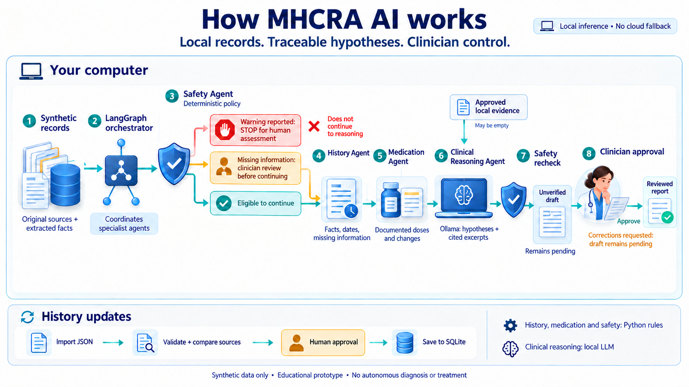
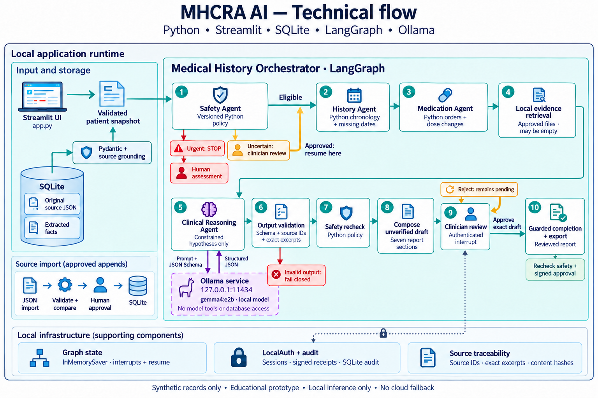

# LOVISA

**Medical History & Clinical Reasoning Assistant**

LOVISA is a local research prototype that turns **synthetic patient records** into
a chronological, source-linked report for clinician review. It combines SQLite,
LangGraph, Streamlit and local Ollama inference. The former project name was
**MHCRA AI**. LOVISA is the project name; its medical-history and clinical-reasoning
function remains the same.

## A clearer local workspace


Sign in and choose one patient. Read the history, optionally inspect CT, then open
**Safety check** to record your assessment and generate a concise draft. The
right-hand **Your review steps** buttons open and scroll to each action; the
**Next action** button points to pending work. **Source records** keeps readable
evidence separate from the main workflow. Changing patients clears unfinished
notes and cancels old work. Background processing stops at 110 seconds if needed.
Actual local synthetic smokes took **1.65s** (fixture CT), **12.43s** (pretrained CT)
and **23.40s** (Ollama clinical workflow). These are individual CPU runs, not
clinical performance claims or guarantees. [Workspace](docs/INTERFACE.md) ·
[Performance and limits](docs/PERFORMANCE.md).

## Two projects, one reviewed workflow

| Project | Input → output | Responsibility |
| --- | --- | --- |
| **LOVISA** — this repository | Synthetic history + accepted CT → concise clinical summary | Organize facts, identify gaps, propose constrained hypotheses and require clinician approval |
| **[Lung CT Research Assistant](https://github.com/LilyC2024/ai-medimg-2.5D-CT)** | Supported CT → nodule candidates, annotations, calipers and research summary | Support source-image inspection and measurement in a separate local environment |

The CT companion can send a validated **synthetic** study to LOVISA. A reviewer
checks its candidates and measurements before accepting the study. The report
includes those inspection results and representative source/annotation images.
A brief clinician note is previewed before final approval. Images and imaging
notes stay outside the language model. [Integration guide](docs/IMAGING.md).

**Research and education only.** Neither project diagnoses cancer, excludes
disease, prescribes treatment or makes automatic medical decisions. LOVISA accepts
fictional records only. Local login does not verify clinical qualifications.

## Understand the workflow



Read left to right: local records → safety check → history and medication
extraction → source-grounded hypotheses → safety recheck → clinician review.
The report now has **one Clinical summary section**: model-selected hypotheses,
CT inspection, essential gaps and a brief clinician note. Detailed citations stay
in the evidence package and an optional evidence view. A portable HTML download
includes CT pictures. [Report example and rules](docs/REPORTS.md).

An urgent warning stops reasoning. Missing safety information pauses for human
assessment. A draft becomes reviewed only after explicit approval of its exact
contents. The retained picture uses the previous **MHCRA AI** name and an earlier
report layout; the current summary replaces its longer report presentation.


The companion adds image evidence: source slice → candidate annotation → physical
caliper. This picture uses generated pixels and a **non-ML fixture finder**. Its
8 mm caliper illustrates software behavior; it is not a clinical finding or a
pretrained-detector accuracy result.

## Agents and models

One `MedicalHistoryOrchestrator` runs four sequential specialist roles:

| Specialist | Implementation | Purpose |
| --- | --- | --- |
| History | Python `MedicalHistoryAgent` | Preserve dates, attribution and missing chronology |
| Medication | Python `MedicationAgent` | Extract supplied orders and documented dose changes |
| Clinical reasoning | `SpecialistAgent("reasoning", inference)` + local Ollama | Select eligible hypothesis/evidence IDs; Python restores exact excerpts |
| Safety | Python `SafetyAgent` + versioned policy | Enforce urgent stops and uncertainty-review holds |

Only clinical reasoning calls the installed `gemma4:e2b` LLM. It selects bounded
catalog/evidence IDs; Python restores exact excerpts, validates citations,
calculates measurements and composes the report. The CT
companion uses pretrained MONAI 3D RetinaNet; it has no LLM agents. Development
coding subagents helped earlier reviews but are not part of either app's runtime.
[Architecture and agent implementation](docs/ARCHITECTURE.md).



Streamlit supplies the interface; SQLite preserves original sources separately
from extracted facts; LangGraph coordinates specialist steps and human interrupts.
Ollama runs on loopback. Completion/export recheck safety, source integrity and
approval. The detailed [picture guide](docs/ILLUSTRATIONS.md) explains the diagrams
and the CT connection.

## Run LOVISA

Use Python **3.10+** and an installed local Ollama service with `gemma4:e2b`.
Reuse `.venv` if present. For a fresh Linux/macOS checkout:

```bash
git clone https://github.com/LilyC2024/Medical-AI.git
cd Medical-AI
python3 -m venv .venv
.venv/bin/python -m pip install -r requirements.lock.txt
.venv/bin/python -m medical_assistant.auth
.venv/bin/python -m streamlit run app.py
```

Open [localhost:8501](http://127.0.0.1:8501), sign in, and select **Taylor Synthetic — checklist
case**. The app seeds fictional examples automatically. Its missing blood pressure
and warning screening intentionally trigger review. [Complete setup](docs/SETUP.md)
includes local Ollama configuration, local-demo account setup and Windows paths;
[first-case instructions](docs/WORKFLOWS.md) explain every approval.

Five additional complex fictional cases cover medicines/dizziness, cough/CT,
fatigue/mixed evidence, a warning-sign stop and conflicting follow-up doses. They
are available in the patient menu after login. Only the selected patient's data
is displayed. Tests are separate from live model inference.
[Cases and expected behavior](docs/DEMO_CASES.md).

Install CT separately with Python **3.12**. The integration supports nodule-v2 and
legacy tissue-mask bundles within a synthetic limit of **64 slices ×256×256**.
Full-size/public-research CT and training remain standalone companion features.
Existing `mhcra-*` formats and `MHCRA_CT_*` settings are stable integration names.
[Naming and compatibility](docs/NAMING.md) · [CT setup](docs/IMAGING.md).

## Documentation and evidence

| Read next | Purpose |
| --- | --- |
| [Documentation index](docs/README.md) | Choose a guide by task |
| [Architecture](docs/ARCHITECTURE.md) | Specialists, storage, models and trust boundaries |
| [Reports and example](docs/REPORTS.md) | Concise combined output, clinician-note preview and image downloads |
| [Records](docs/RECORDS.md) | Synthetic JSON, sources and local references |
| [Imaging](docs/IMAGING.md) | Connect, inspect, measure and accept CT results |
| [Code reference](docs/CODE_REFERENCE.md) | Modules, functions and folders |
| [Validation](docs/VALIDATION.md) / [Evaluation](EVALUATION.md) | Reproduce checks; distinguish tests from actual inference |
| [Release history](docs/RELEASE.md) | Changes, naming and migration |

Current software checks, actual local model timings and publication checks are
recorded in [EVALUATION.md](EVALUATION.md). Scripted tests and live inference are
reported separately.

Operation uses no paid APIs, cloud inference or remote tracing. Setup may download
packages and weights explicitly. Keep both apps local; pending work is in memory
and disk storage is not encrypted. [Security](SECURITY.md) ·
[Contributing](CONTRIBUTING.md). LOVISA has no selected project-wide redistribution
license; [vendored CT components retain MIT terms](third_party/README.md).
