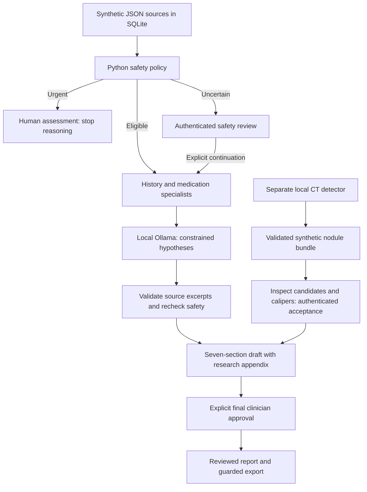

# MHCRA AI

**Medical History & Clinical Reasoning Assistant — v0.2.0.** A local Python
prototype that organizes **synthetic patient histories** and prepares a
source-linked, seven-section report for clinician review. SQLite stores original
sources and facts; LangGraph coordinates four specialists; local Ollama supplies
constrained reasoning; Streamlit provides the interface.

The optional [lung CT companion](https://github.com/LilyC2024/ai-medimg-2.5D-CT)
now connects its current candidate detector, source annotations and reviewable
calipers to MHCRA. CT inference stays in a separate environment. Images and
imaging notes never enter the LLM. No paid APIs, cloud inference or remote tracing.

**Educational and experimental; not a diagnostic device.** No cancer diagnosis,
disease exclusion, treatment decisions or clinically validated accuracy is
claimed. All conclusions require clinician verification. Do not enter real patient
data. Local accounts authenticate users, not professional credentials.

## What you can do

- Inspect chronological records, original sources and documented medication changes.
- Preserve missing dates, unavailable blood pressure and patient-reported attribution.
- Generate bounded hypotheses with exact record excerpts after deterministic safety checks.
- Inspect synthetic CT candidates, explicitly accept/reject each, and preview a physical caliper.
- Add authenticated research imaging to a draft; approve that exact final draft separately.


The figure uses generated pixels and the **non-ML fixture finder**; it demonstrates
annotation and measurement, not detector accuracy or a clinician-approved finding.
Actual pretrained MONAI inference is checked separately. The earlier clinical
workflow and technical-flow pictures remain in the
[illustrated guide](docs/ILLUSTRATIONS.md), with explanatory text and editable flow source.

## How it works



Pending imaging blocks draft generation. Urgent clinical routing takes priority;
images cannot lower escalation. Imaging acceptance and final report approval are
distinct. New imports require a new case snapshot. [Exact graph and trust boundaries](docs/ARCHITECTURE.md).

## Agents and model

| Runtime role | Implementation | Responsibility |
| --- | --- | --- |
| History | `MedicalHistoryAgent.run`, Python `RunnableLambda` | Grounded chronology, attribution and undated entries |
| Medication | `MedicationAgent.run`, Python `RunnableLambda` | Structured orders and documented dose changes; reconciliation questions |
| Clinical reasoning | `SpecialistAgent("reasoning", inference)` | Local Ollama JSON constrained to an eligible synthetic hypothesis catalog |
| Safety | `SafetyAgent.evaluate`, Python plus versioned policy | Urgent stop, uncertainty review or ordinary workflow eligibility |

`MedicalHistoryOrchestrator` builds a sequential LangGraph `StateGraph(CaseState)`.
Only reasoning invokes the installed `gemma4:e2b` LLM. The other roles and report
composition use Python. Graph interrupts require human decisions; models have no
database, shell, approval or CT tools. CT uses a computer-vision model, not an LLM
agent. [Agent internals](docs/ARCHITECTURE.md) · [Function/folder reference](docs/CODE_REFERENCE.md).

Development previously used coding review subagents for records, safety and
release review. Those assistants are not shipped runtime agents, and software
review is not clinical verification. This compatibility update used implementation,
adversarial tests and real local smoke checks. [Development record](docs/DEVELOPMENT.md).

## Start locally

MHCRA uses Python **3.10+**; hosted regression targets 3.10 and 3.12. Reuse `.venv`
when present. Fresh Linux/macOS checkout:

```bash
git clone https://github.com/LilyC2024/Medical-AI.git
cd Medical-AI
python3 -m venv .venv
.venv/bin/python -m pip install -r requirements.lock.txt
.venv/bin/python -m medical_assistant.auth
.venv/bin/python -m streamlit run app.py
```

Run the installed Ollama service on loopback with `OLLAMA_NO_CLOUD=1`; explicitly
install `gemma4:e2b` if absent. Setup packages/weights need internet; runtime inference
is local. The app seeds fictional fixtures idempotently. Open
[localhost:8501](http://127.0.0.1:8501), sign in and choose **Taylor Synthetic — checklist case**.
Its missing blood pressure and screening intentionally trigger a safety review.
[Complete setup](docs/SETUP.md) · [First case/import/approval walkthrough](docs/WORKFLOWS.md).

## Current CT compatibility

Use the current companion checkout in a **separate Python 3.12 environment**;
MHCRA itself needs neither PyTorch nor MONAI. Default sibling discovery can be
overridden with `MHCRA_CT_ROOT`; installed weights with `MHCRA_CT_MODEL_DIR`.

| CT output or capability | MHCRA support |
| --- | --- |
| `mhcra-lung-nodules-v2` | Source HU, every-slice previews, candidates, provenance and optional producer review; MHCRA decisions/calipers and authenticated acceptance required |
| Fixture or installed pretrained detector | Both launchable locally; CPU or explicit available CUDA for pretrained only |
| Legacy `mhcra-imaging-v1` | Existing tissue-mask viewer, worker and appendix retained |
| Incomplete `mhcra-lung-nodules-v1` | Rejected with migration instruction: re-export original workspace using current CT |
| Public research DICOM, training and full-size CT | Standalone CT only; not imported into MHCRA's synthetic database |

Nodule exchange is bounded to 64 slices ×256×256; MHCRA is not a clinical DICOM/PACS
viewer or a training front end. Detector scores are not malignancy probabilities;
box extents are not lesion diameters. Calipers are reviewer-selected in-plane
distances. [CT installation, use, wire contract and migration](docs/IMAGING.md).

## Verify and reproduce

```bash
.venv/bin/python -m pytest -q
.venv/bin/python scripts/sync_ct_contracts.py --ct-root ../ai-medimg-2.5D-CT
.venv/bin/python scripts/smoke_imaging.py --mode lung-fixture
.venv/bin/python scripts/smoke_imaging.py --mode lung-pretrained --model-dir ../ai-medimg-2.5D-CT/models/luna16
.venv/bin/python scripts/smoke_local.py --model gemma4:e2b
```

Offline tests use temporary databases and scripted inference/reviewers. Real CT
and Ollama smokes are separate and never approve final clinical reports. See
[actual evaluation](EVALUATION.md), [phase gates](PLAN.md) and
[validation guide](docs/VALIDATION.md) for outcomes and limits.

## Documentation and project map

| Need | Guide |
| --- | --- |
| Installation, model and account setup | [Setup](docs/SETUP.md) |
| First case, source import, safety and final approval | [Workflows](docs/WORKFLOWS.md) |
| JSON records, references and extension rules | [Records](docs/RECORDS.md) |
| LangGraph specialists, storage and inference boundaries | [Architecture](docs/ARCHITECTURE.md) |
| CT setup, review, exchange and compatibility | [Imaging](docs/IMAGING.md) |
| Classes, functions, subfunctions and folders | [Code reference](docs/CODE_REFERENCE.md) |
| Test methods and reproducing results | [Validation](docs/VALIDATION.md) |
| Changes and migration | [Release](docs/RELEASE.md) |

[Documentation index](docs/README.md) · [Tracked-file inventory](docs/FILE_INVENTORY.md) ·
[Security](SECURITY.md) · [Contributing](CONTRIBUTING.md).

Single-machine prototype: pending cases/sessions/proposals are in memory; SQLite
sources, audit and saved reports persist. Storage is not encrypted. Keep Streamlit
and Ollama local. The structured safety policy is not a comprehensive emergency
text detector. The evidence collection is empty by default. MHCRA has no selected
redistribution license; review that and dependency/model licenses before reuse.
