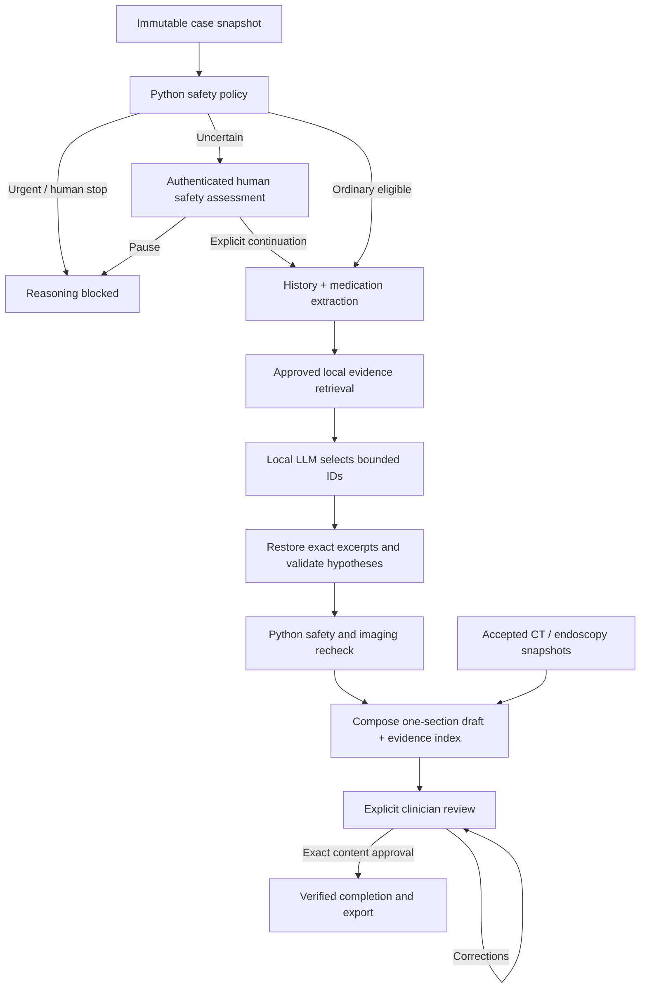

# LOVISA architecture, agents and data flow

[Overview](../README.md) · [Code reference](CODE_REFERENCE.md) · [Clinical contracts](reference/CLINICAL.md)

## Runtime components

| Component | Implementation | Responsibility |
| --- | --- | --- |
| Orchestrator | `MedicalHistoryOrchestrator`, LangGraph `StateGraph` | Fixed case snapshot, sequential roles, human interrupts, composition and guarded completion |
| History specialist | Python `MedicalHistoryAgent` | Chronology, known/unknown dates and documented/reported attribution |
| Medication specialist | Python `MedicationAgent` | Source-supplied orders, discrepancies and dated changes; never prescribe |
| Reasoning specialist | `SpecialistAgent("reasoning", inference)` with local Ollama | Select eligible hypothesis/evidence IDs under a constrained schema |
| Safety specialist | Python `SafetyAgent` and versioned local JSON policy | Urgent stop, uncertainty hold and repeated safety checks |
| Local retrieval | `LocalEvidenceCollection` | At most three explicitly approved/hash-verified local excerpts; empty by default |
| CT adapter | `LocalCTJob` | Separate bounded companion process; fixture/pretrained/legacy modes |
| Endoscopy adapter | `LocalEndoscopyJob` | Separate bounded CV process; installed local backend and exact source/provenance |

The specialists are software roles, not four independent LLM conversations: the
system is a deterministic workflow with one constrained LLM step, not a
multi-agent system.
LangChain runnables wrap deterministic extraction/retrieval; only reasoning calls
`gemma4:e2b`. Imaging adapters do not have database or approval tools. Expert coding
review agents are development collaborators, not shipped runtime components.

## Clinical graph

The UI first prepares safety without running the LLM. A separate Generate action
continues reasoning only when the same snapshot remains eligible. Urgent routing
precedes optional image checks. An uncertain case cannot infer safety from missing
blood pressure or screening. The model cannot change the Python route.

## Schemas and persistence

| Structure/store | Contract |
| --- | --- |
| `PatientRecord`, `Entry`, `SourceDocument` | Fictional identity, exact supplied dates/attribution/fields, immutable original JSON and source links |
| `Assessment` | Typed findings, structured orders and bounded hypothetical explanations |
| `Review` | Authenticated actor, explicit attestation/decision, optional notes and exact draft digest |
| `ReportNote` | Authenticated case-bound commentary; never an imported clinical fact |
| `CaseState` | Frozen record, assessments, safety decisions, evidence, accepted imaging and review receipts |
| SQLite | Parameterized transactional originals, extracted facts, accounts, accepted imaging and audit records |
| Local image directories | Original ZIP/artifacts and immutable accepted snapshots |
| In-memory graph/session | Pending checkpoints, proposals, worker handles, session tokens and receipt key |

Original sources are separate from extraction. Unsupported fields/excerpts fail
closed. SQLite is local and unencrypted; restarting loses pending graph/session
state. Historical exports are not silently revised or reapproved.

## LLM protocol and grounding

The adapter connects only to `127.0.0.1:11434`, disables proxies/redirects and
rejects remote-backed models. It requests temperature zero, JSON Schema and a
16,384-token context. Compact reasoning uses eligible catalog/evidence IDs, not
free-form medical assertions. Python restores exact original text/attribution,
expands the response and runs the full assessment checks. An 11,000-byte combined
prompt/schema budget rejects oversized valid records rather than dropping facts.
The model has no shell, filesystem, database or approval tools.

The hypothesis catalog is deliberately small and educational. No image model,
accepted study or reviewer note expands it into cancer diagnosis or general disease
coverage. [Catalog and evidence rules](RECORDS.md).

## Imaging and report boundary

A ZIP is independently validated against modality-specific source/geometry/
probability/mask/annotation contracts. Public formats require provenance and a
fictional composite case. Every candidate must be explicitly resolved before
image acceptance. CT uses source z/y/x, physical LPS and optional manual calipers;
endoscopy uses RGB pixels and half-open xyxy regions. They are not interchangeable.

Python appends accepted observations and representative verified pictures after
history reasoning. Neither pixels nor imaging notes enter Ollama. Final approval
binds visible prose and a hidden content manifest containing sources, model
selections, image snapshots and notes. Same prose with different evidence fails.
[CT](IMAGING.md) · [Endoscopy](ENDOSCOPY.md) · [Reports](REPORTS.md).

## UI lifecycle and response budget

Only the selected workspace renders. Switching patient/logout cancels work,
discards pending proposals and clears patient-specific controls. Fixed guide
anchors never use record/model text as executable content. Shared Upload/Analyze
routing validates input before retiring an old report context; new context requires
safety again. Pending studies cannot be overwritten silently.

Clinical workers publish only inside a 110-second deadline; process workers have
bounded cancellation. Saturated worker capacity is a recoverable UI error, not a
crash or permission to skip checks. `ui.errors.error_message` renders bounded
literal explanations, omitting uploaded Pydantic values and help URLs. Detailed
sources remain in their dedicated view. [Performance](PERFORMANCE.md) ·
[Expert repairs](REVIEW.md) · [Security](../SECURITY.md).
