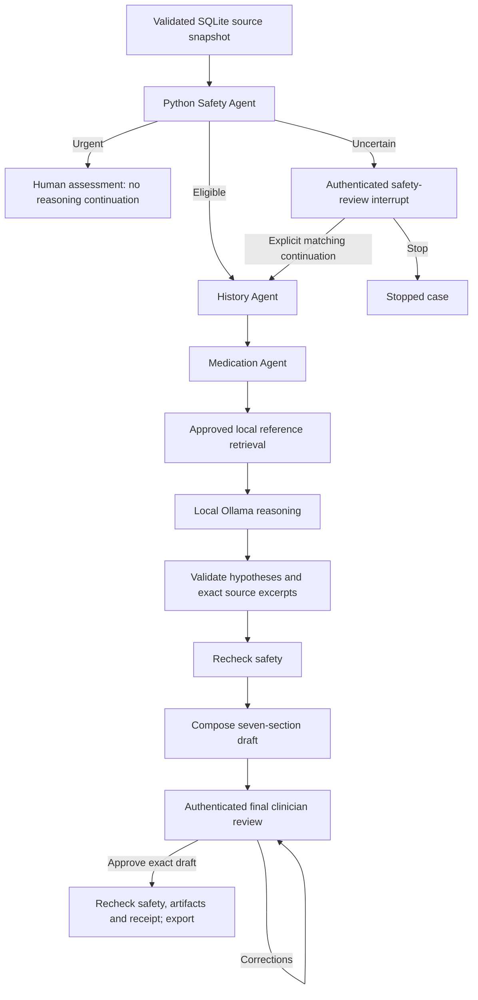

# LOVISA architecture and agents

[Overview](../README.md) · [Illustrations](ILLUSTRATIONS.md) · [Code reference](CODE_REFERENCE.md)

LOVISA organizes synthetic history and prepares a clinician-reviewed report. The
CT companion detects image candidates in its own process/environment. Their only
shared input to the clinical report is a validated, human-accepted research study.

## Clinical workflow

`MedicalHistoryOrchestrator` creates `StateGraph(CaseState)` and runs specialist
steps sequentially. `InMemorySaver` holds pending state; `interrupt()` and
`Command(resume=...)` implement human pauses. No model call follows final approval.

## Four specialist implementations

| Specialist | Class/node | How it works |
| --- | --- | --- |
| History | `MedicalHistoryAgent.run()` | Python chronology and attribution; unknown dates remain unknown |
| Medication | `MedicationAgent.run()` | Python extraction of supplied structured orders; only dated documented orders establish a dose change |
| Reasoning | `SpecialistAgent("reasoning", inference)` | Ollama structured JSON, then Python schema/catalog/source validation |
| Safety | `SafetyAgent.evaluate()` | Versioned local Python policy; model output cannot lower escalation |

LangChain `RunnableLambda` wraps history, medication and local reference retrieval.
Only the reasoning specialist calls an LLM. Generic role prompts remain in the
source, but the runtime graph uses inference only for reasoning. These specialists
are bounded classes/nodes, not independent chat services or autonomous tool users.

## Sources and reasoning

SQLite keeps original JSON and SHA-256 separately from extracted facts. Exact
repeated imports are idempotent; conflicting immutable IDs fail transactionally.
Record-derived text requires real source IDs, exact excerpts and matching
patient-reported/documented attribution. Missing dates and measurements are never
filled by inference.

Reasoning uses a small synthetic hypothesis catalog. A medication entry allows a
medication-related possibility; a whole-word mention of sleep allows a sleep-related
possibility, including negated text. These are demonstration eligibility rules,
not diagnostic criteria. Unknown labels, invented references, unsupported excerpts
or invalid JSON block the draft. Approved local references may be empty.

The Ollama adapter is fixed to `127.0.0.1:11434`, disables proxies/redirects and
rejects remote-backed models. Generation requests JSON Schema, temperature zero
and a 16,384-token context. An 11,000-byte combined prompt/schema budget rejects
oversized requests. The model has no database, filesystem, shell or approval tools.

## Safety and review

Any supplied structured warning marked present triggers an urgent stop, even when
historical. Missing/uncertain current screening or blood pressure requires a
matching authenticated assessment before reasoning. Ordinary eligibility is not a
statement of clinical safety. Safety is rechecked after reasoning and at export.

Imports, safety continuation and final approval bind the authenticated account,
case/content hash, notes and attestation. Rejection stays pending. Corrections to
facts require an approved new source and a new case. Active cases retain their
original source/imaging snapshot; later database imports are not silently included.

## CT boundary

The separate CT worker runs a non-ML fixture, installed pretrained detector or
legacy demo. LOVISA dispatches nodule-v2 and legacy mask-v1 to separate validators.
Nodule source HU, every preview, typed candidates and canonical producer report
must agree. Uploaded hashes establish consistency, not execution authenticity.

LOVISA requires its own authenticated candidate/caliper review. The acceptance
hash covers the original bundle and exact choices. Python adds an escaped,
source-linked research appendix after clinical reasoning. Images and imaging
notes never enter the LLM or expand its hypothesis catalog. Final approval covers
the appendix; completion/export/persistence recheck artifacts. Urgent routing
precedes optional image checks. [Contract details](IMAGING.md).

## Persistence

| Persistent on local disk | Process/session memory |
| --- | --- |
| SQLite sources/facts, accounts and audit | Pending graph checkpoints and proposals |
| Accepted original CT ZIP/HU/previews | Active CT job handles |
| Saved reviewed report exports | Login sessions and receipt verification keys |

Restarting loses pending work. Storage is not encrypted; process/filesystem/database
administrators remain trusted. Local authentication does not verify professional
credentials. [Security](../SECURITY.md).
