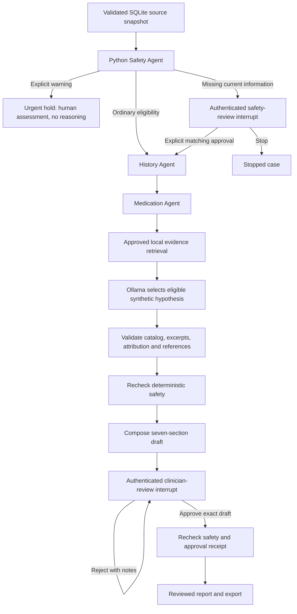

# Architecture

MHCRA AI separates storage, extraction, policy, inference and presentation.
Runtime agents are bounded components, not autonomous processes with unrestricted
tools. The model has no database, filesystem, shell or network tools. Python
performs persistence and approval checks.

## Clinical-review graph

LangGraph uses `InMemorySaver` and `interrupt`/`Command(resume=...)`. Safety
interrupts occur before reasoning; safety also runs after reasoning and during
completion/export. Policy and record hashes bind the decision to its inputs.
No LLM executes after final approval. Rejected reports remain pending; fact
corrections go through approved new source imports and a fresh assessment.

## History-management workflow

`HistoryManagement.prepare()` parses synthetic JSON, attaches its original source,
validates exact grounding and compares existing entry IDs. History and medication
extraction produce a review proposal. A content hash binds review to that proposal.
`approve()` requires authentication, explicit attestation and a matching hash,
then appends facts transactionally. Exact duplicate retries are harmless;
conflicting IDs fail. No model writes or modifies records.

## Module responsibilities

| Module | Responsibility |
| --- | --- |
| `app.py` | Streamlit record selection and human review forms |
| `models.py` | Strict Pydantic records, assessments and review contracts |
| `database.py` | stdlib SQLite transactions, immutable sources, idempotent seed and reads |
| `grounding.py` | Compare extracted fields against original JSON entries |
| `history.py` | Deterministic chronology and structured medication extraction |
| `history_import.py` | Pending proposals and human-approved appends |
| `safety.py`, `config/safety_policy.json` | Versioned deterministic routing without model override |
| `evidence.py` | Hash-verified local text retrieval through `RunnableLambda` |
| `agents.py` | Specialist prompts and constrained inference validation |
| `reasoning_constraints.py` | Eligible synthetic hypothesis catalog and allowed narrative vocabulary |
| `ollama_client.py` | Fixed-loopback adapter and local-model metadata checks |
| `workflow.py` | LangGraph coordination, interrupts and guarded completion/export |
| `auth.py` | Password hashes, expiring sessions, signed approval receipts and audit writes |
| `report.py` | Deterministic report sections, citations and content hashing |
| `storage.py` | Fixture loading and guarded local report persistence |

The generic specialist prompt module retains role definitions for all four
specialties. The clinical graph invokes inference for reasoning only; history,
medication and safety use dedicated Python implementations.

## Source and uncertainty boundaries

Original source JSON and extracted facts occupy separate SQLite tables. Source
content is hashed and source IDs cannot silently be reused for changed content.
Fact IDs are unique within each patient. Unknown dates stay `None`; undated
entries follow known chronology with an explicit label. Dose changes require
dated, documented structured orders; ambiguous same-day sequences are flagged.

Record-derived model statements must be exact source excerpts. Hypotheses have
`status="hypothesis"`, supporting excerpts and explicit uncertainty. Reasoning is
limited to a synthetic catalog and applicable source conditions rather than
unrestricted diagnostic or treatment generation. References must come from the
supplied approved local collection. These constraints provide no clinical proof.

The catalog always permits insufficient information/other unestablished causes.
A medication entry permits a medication-related contribution hypothesis; the
word “sleep” in a record permits a sleep-related contribution hypothesis. These
are transparent demonstration eligibility rules, not diagnostic criteria or a
test of causation. The model selects eligible labels and complete source-entry
excerpts. Uncertainty, follow-up considerations, missing-information statements
and clinician questions are constrained to fixed vocabulary and checked again in
Python after inference, even if the transport ignores the generation schema.

## Inference boundary

The adapter calls only `http://127.0.0.1:11434`. It disables environment proxies
and redirects, rejects cloud model names and remote-backed metadata, and requires
local parameter metadata. Run Ollama with cloud features disabled as well.
Structured generation uses JSON Schema, temperature zero, a requested 16,384-token
context and bounded output. A conservative 11,000-byte combined prompt/schema
budget fails oversized requests instead of allowing silent truncation. Hardware
and model support affect speed and reliability.

Tracing switches are disabled before graph imports. Dependency installation and
model downloads are separate setup operations; inference never falls back to an
external provider.
