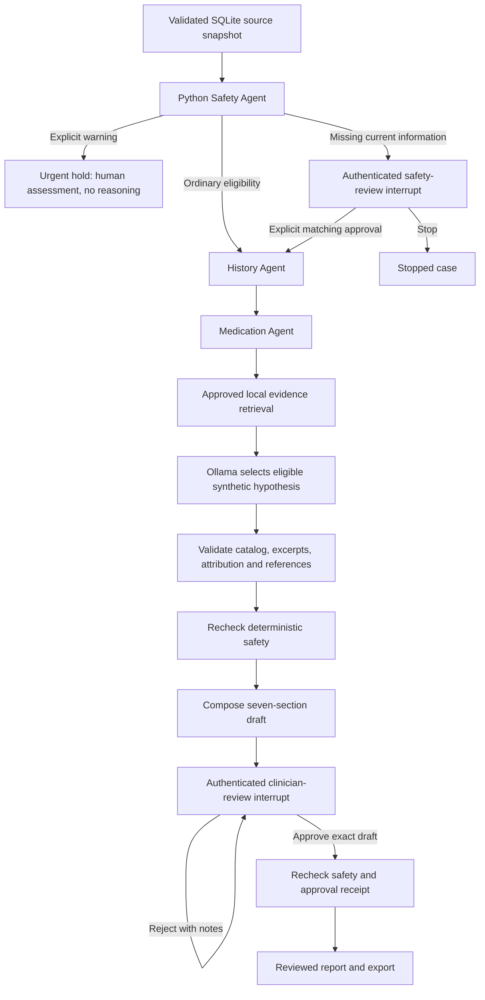

# Architecture

MHCRA AI separates storage, extraction, policy, inference and presentation.
Runtime agents are bounded components, not autonomous processes with unrestricted
tools. The model has no database, filesystem, shell or network tools. Python
performs persistence and approval checks.

## Clinical-review graph

The [README](ILLUSTRATIONS.md) includes illustrated clinical
and technical overviews. The graph below is the precise transition reference;
its [editable technical diagram](images/mhcra-ai-technical-flow-v1.mmd) also shows
storage, inference and supporting services.

LangGraph uses `InMemorySaver` and `interrupt`/`Command(resume=...)`. Safety
interrupts occur before reasoning; safety also runs after reasoning and during
completion/export. Policy and record hashes bind the decision to its inputs.
No LLM executes after final approval. Rejected reports remain pending; fact
corrections go through approved new source imports and a fresh assessment.
The patient snapshot is loaded once at case start. Rechecks use that snapshot;
later imports in SQLite are not automatically detected or included in an active
case. Start a new case to include newly approved facts. Any structured warning
marked present in the snapshot triggers the urgent hold, regardless of its date.

## History-management workflow

`HistoryManagement.prepare()` parses synthetic JSON, attaches its original source,
validates exact grounding and compares existing entry IDs. History and medication
extraction produce a review proposal. A content hash binds review to that proposal.
`approve()` requires authentication, explicit attestation and a matching hash,
then appends facts transactionally. Exact duplicate retries are harmless;
conflicting IDs fail. No model writes or modifies records.

## Module responsibilities

| Module | Responsibility |
| --- | --- |
| `app.py` | Streamlit record selection and human review forms |
| `runtime.py` | Idempotently seed bundled fixtures and cache shared local authentication services |
| `ct_worker.py` | Separate local CT interpreter, bounded jobs, cancellation and watchdog |
| `imaging_contract.py`, `nodule_exchange.py` | Version dispatch; bounded ZIP/NPY/PNG validation and geometry/overlay checks |
| `imaging.py`, `imaging_ui.py` | Separate accepted-study storage, authenticated acceptance and source/overlay inspection |
| `nodule_models.py`, `nodule_support.py`, `nodule_ui.py` | Shared typed nodule schemas; candidate/caliper acceptance binding and viewer |
| `models.py` | Strict Pydantic records, assessments and review contracts |
| `database.py` | stdlib SQLite transactions, immutable sources, idempotent seed and reads |
| `grounding.py` | Compare extracted fields against original JSON entries |
| `history.py` | Deterministic chronology and structured medication extraction |
| `history_import.py` | Pending proposals and human-approved appends |
| `safety.py`, `config/safety_policy.json` | Versioned deterministic routing without model override |
| `evidence.py` | Hash-verified local text retrieval through `RunnableLambda` |
| `agents.py` | Specialist prompts and constrained inference validation |
| `reasoning_constraints.py` | Eligible synthetic hypothesis catalog and allowed narrative vocabulary |
| `ollama_client.py` | Fixed-loopback adapter and local-model metadata checks |
| `workflow.py` | LangGraph coordination, interrupts and guarded completion/export |
| `auth.py` | Password hashes, expiring sessions, signed approval receipts and audit writes |
| `report.py` | Deterministic report sections, citations and content hashing |
| `storage.py` | Fixture loading and guarded local report persistence |

The generic specialist prompt module retains role definitions for all four
specialties. The clinical graph invokes inference for reasoning only; history,
medication and safety use dedicated Python implementations.

## Source and uncertainty boundaries

Original source JSON and extracted facts occupy separate SQLite tables. Source
content is hashed and source IDs cannot silently be reused for changed content.
Fact IDs are unique within each patient. Unknown dates stay `None`; undated
entries follow known chronology with an explicit label. Dose changes require
dated, documented structured orders; ambiguous same-day sequences are flagged.

Record-derived model statements must be exact source excerpts. Hypotheses have
`status="hypothesis"`, supporting excerpts and explicit uncertainty. Reasoning is
limited to a synthetic catalog and applicable source conditions rather than
unrestricted diagnostic or treatment generation. References must come from the
supplied approved local collection. These constraints provide no clinical proof.

The catalog always permits insufficient information/other unestablished causes.
A medication entry or structured order permits a medication-related contribution
hypothesis; a whole-word, case-insensitive match for “sleep” permits a sleep-related
contribution hypothesis, including a negated mention. These
are transparent demonstration eligibility rules, not diagnostic criteria or a
test of causation. The model selects eligible labels and complete source-entry
excerpts. Uncertainty, follow-up considerations, missing-information statements
and clinician questions are constrained to fixed vocabulary and checked again in
Python after inference, even if the transport ignores the generation schema.

## Inference boundary

The adapter calls only `http://127.0.0.1:11434`. It disables environment proxies
and redirects, rejects cloud model names and remote-backed metadata, and requires
local parameter metadata. Run Ollama with cloud features disabled as well.
Structured generation uses JSON Schema, temperature zero, a requested 16,384-token
context and bounded output. A conservative 11,000-byte combined prompt/schema
budget fails oversized requests instead of allowing silent truncation. Hardware
and model support affect speed and reliability.

Tracing switches are disabled before graph imports. Dependency installation and
model downloads are separate setup operations; inference never falls back to an
external provider.

## Optional shared CT workbench

See [IMAGING.md](IMAGING.md). A configured companion checkout generates synthetic
CT and runs its model in an isolated Python 3.12 subprocess. MHCRA reads only a
bounded, internally consistent inspection bundle. SQLite keeps accepted imaging
separate from clinical facts, with immutable original ZIP/manifest files and
derived previews/masks under ignored `data/imaging/`.

Authenticated imaging acceptance binds the manifest/archive to a reviewer and
study. Starting a clinical case captures accepted imaging snapshots. Python adds
a research appendix after normal clinical composition; no imaging or reviewer
notes enter the LLM or hypothesis catalog. The final draft hash covers the appendix.
Composition, completion, export and persistence verify accepted artifact integrity.
Urgent clinical cases enter the safety hold without waiting for optional image
checks. Uploaded execution metadata is a producer declaration; hashes do not
independently authenticate synthetic origin or model execution.

## Current nodule exchange

`imaging_contract.validate_bundle` dispatches nodule-v2 to the shared ML-free
validator and leaves the legacy mask validator separate. Source HU and every
preview are checked before a proposal exists. `nodule_support` binds a typed,
fully resolved candidate review to authenticated imaging acceptance. Original
producer review is preserved separately; MHCRA decisions are not written back
into producer files. `nodule_ui` recomputes accepted caliper overlays from original
HU. The deterministic canonical research report is escaped and placed in the
research appendix; it never becomes a clinical source fact or LLM prompt.

`verify_nodule_snapshot` checks the decisions/calipers, study digest, authenticated
reviewer identity and acceptance hash; ImagingStore also validates every accepted
artifact. Existing graph guards invoke this at composition, completion and export.
The final draft hash includes the appendix. [Contract and trust limits](IMAGING.md).
