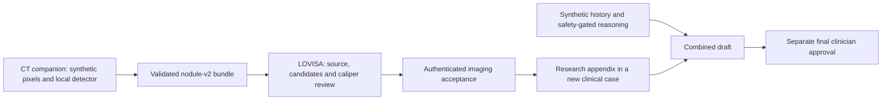

# The two projects in pictures

[Overview](../README.md) · [Architecture](ARCHITECTURE.md) · [CT integration](IMAGING.md)

## 1. LOVISA: from history to reviewed report

Read left to right. Original synthetic records enter the orchestrator. Python
checks safety before any reasoning: an urgent warning stops; missing safety data
requires human assessment. History and medication specialists organize facts.
Local Ollama proposes constrained hypotheses. A safety recheck and explicit
clinician approval precede the reviewed report. The lower strip shows separate
human approval for history imports.

The retained image uses **MHCRA AI**, LOVISA's former name. “Eligible to continue”
means workflow eligibility, not confirmation of medical safety.

## 2. LOVISA: the software components

Streamlit is the UI. SQLite stores original JSON separately from facts. LangGraph
runs sequential role components and pauses for review. Only the reasoning node
calls local Ollama (`gemma4:e2b`, `127.0.0.1:11434`). Python checks returned JSON,
source IDs and exact excerpts. Authentication binds approvals to the exact draft;
completion/export verify safety and integrity again. Pending state is in memory.

[Editable Mermaid](images/mhcra-ai-technical-flow-v1.mmd) describes the clinical
graph. The original [workflow prompt](images/mhcra-ai-workflow-v1.prompt.txt) and
[technical prompt](images/mhcra-ai-technical-flow-v1.prompt.txt) preserve how the
pictures were produced. Image generation was documentation work, not app inference.

## 3. CT companion: from pixels to reviewable annotations

Left: generated CT-like source pixels. Middle: a candidate box. Right: an in-plane
8 mm example caliper. Amber denotes a candidate; cyan denotes a manual measurement.
This figure uses a non-ML fixture finder, not the pretrained detector. It shows
annotation/measurement behavior, not cancer diagnosis or clinical accuracy.

## 4. Connect image evidence to history

The transfer is a bounded local file bundle. LOVISA verifies original bytes and
annotations; it sends no images to the LLM. Accepting imaging cannot lower safety
escalation or approve the final report. [Limits and exact contract](IMAGING.md).

## Historical tissue-mask figure

This earlier picture shows heuristic tissue classes, counts and overlays from the
retained legacy bridge. Its segmentation metrics are not nodule-detection results.

## Current workspace

The current light interface shows exact fictional source text and policy status.
[Operating guide](INTERFACE.md) · [Responsiveness and timings](PERFORMANCE.md).
