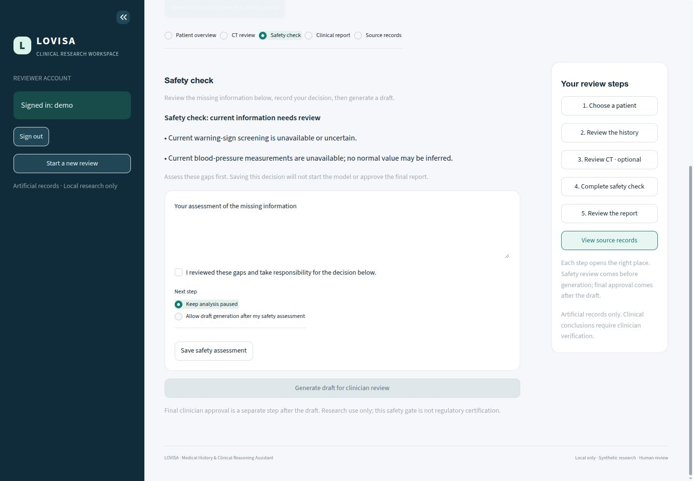
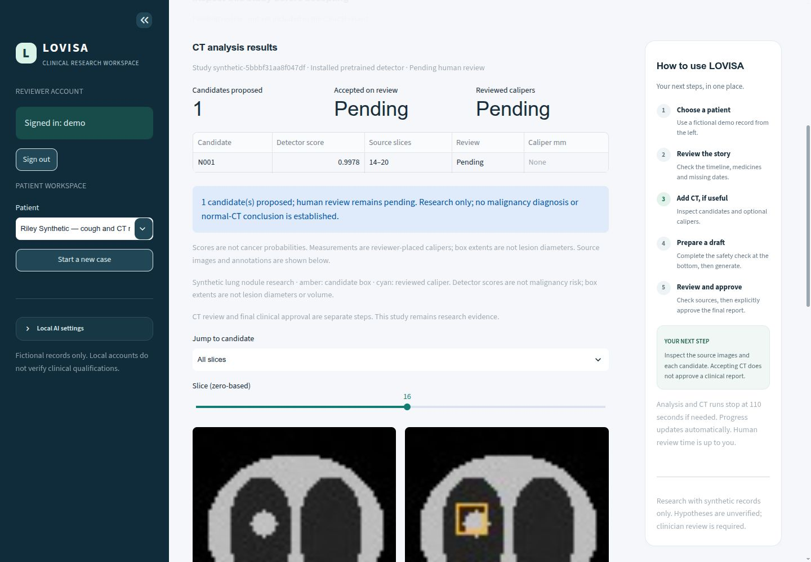

# LOVISA workspace

[Overview](../README.md) · [First case](WORKFLOWS.md) · [Response budgets](PERFORMANCE.md)

## One patient, six focused views

Sign in, then choose a patient in the menu above the workspace. No patient is
selected automatically. The menu lists artificial examples; the page displays
only the selected person's history, CT and report. Switching patients cancels
unfinished jobs and clears notes, proposals and report state. Accepted records
remain stored for the patient they belong to.

| View | What you can do |
| --- | --- |
| Patient overview | Read dated/undated history, attribution and historical medicines |
| CT review | Upload/Analyze a review ZIP or local example, inspect annotations and review candidates/calipers |
| Endoscopy review | Upload/Analyze a permitted image or review ZIP, inspect and decide on each region |
| Safety check | Assess missing information, save your decision, then generate a draft |
| Clinical report | Read one concise summary with CT pictures, preview a brief note, then approve or request corrections |
| Source records | Check original wording, download the input original or approve an additional synthetic record |

The **Next action** button points to pending record/CT reviews, safety or the
report. On the right, **Your review steps** buttons open the matching view and
scroll directly to its action. **Choose a patient** returns to the patient menu.
On narrow screens the guide stacks below the view; Next action remains near the
top. Navigation never runs inference or supplies an approval.

## Safety before generation

Open **Safety check** from its tab, Next action or its labelled guide step. The form
lists actual policy gaps. Optionally add notes, retain the selected confirmation, choose the intended
decision and save it. Saving does not call the model. Only after the required
checks does **Generate draft for clinician review**, at the bottom of this view,
become available. Warning signs block generation. Pending CT/import changes have
an **Open pending changes** button so they can be reviewed or discarded first.

The locked button demonstrates the gate; it is not a clinical safety conclusion.
Final report approval remains a separate action in Clinical report. Previewing a
clinician note updates the text and restores the selected confirmation default; it does not
approve the report. [Report format and downloads](REPORTS.md). This is a
research safeguard, not regulatory certification.

## CT and evidence

Completed CT results appear automatically before review controls. The panel shows
candidate counts, review status, source/annotation slices and reviewed calipers.
Accepted results remain inspectable after clinical analysis. An empty panel says
when no study is attached. An urgent warning takes priority over optional CT.

The figure above is a non-ML generated fixture, not a trained detector result.
The separate installed-detector screenshot below is an actual CPU run on generated
32×64×64 pixels. Neither image establishes diagnostic accuracy or cancer risk.

The main workflow contains no raw JSON, hashes, model paths or extraction dumps.
Source filenames/dates and exact wording remain accessible in **Source records**.
Full metadata still undergoes validation and remains in evidence exports. CT paths
and device are configured locally, as described in [Imaging](IMAGING.md).

## Reusable local components

`ui/theme.css` supplies design tokens, cards and responsive layout;
`ui/components.py` supplies escaped presentations and the guide;
`ui/navigation.py` handles fixed destinations and patient cleanup;
`ui/imaging_actions.py` renders shared Upload/Analyze controls;
`imaging_actions.py` validates/routes inputs and collects bounded job results;
`ui/clinical.py` handles safety/report actions; `ui/history.py` handles imports.
`app.py` renders one selected view. Native Streamlit forms and buttons retain
keyboard interaction. A small local scroll helper uses only fixed app anchors;
record/model text never enters its JavaScript. No remote fonts, templates or
frontend service are loaded.

SQLite, Ollama and the separate CT environment remain local. This version uses
[localhost:8501](http://127.0.0.1:8501); it has no public domain or cloud inference.

## Image-first endoscopy extension

The **Endoscopy review** workspace adds source/overlay images, pixel-area results and explicit candidate decisions. Its linked guide step opens that view. [Operation](ENDOSCOPY.md).

## Research-image and review update

Review confirmations start selected and green; notes are optional. Pause/corrections
choices are yellow and allow/approve choices green, with larger decision labels.
Colour indicates a selection, never a completed approval. Every image candidate
needs an include/exclude choice before the separate submit action. Blank final
notes need no preview; changed nonempty notes must be previewed before approval.
The Jordan composite adds local research examples and permitted endoscopy JPG upload.
Model scores and provenance hashes stay out of primary results. [Research guide](RESEARCH_IMAGES.md).

## Upload and Analyze

Both image views put the same two actions above their results. **Upload** opens
one file picker; **Analyze** uses the selected file. **Model / example** selects
an example only when no file is selected. Remove the selected upload to use an
example instead. No separate inspect/run/import button is needed.

The page explains pending-review and active-job blockers. Errors stay visible
beside Analyze and retries remain available. Analyze after an existing clinical
case starts opens a fresh context only after input validation; it never changes
an old approval or saved report. Image inclusion, safety and final review retain
separate explicit submissions. Urgent policy warnings still pause image actions.
