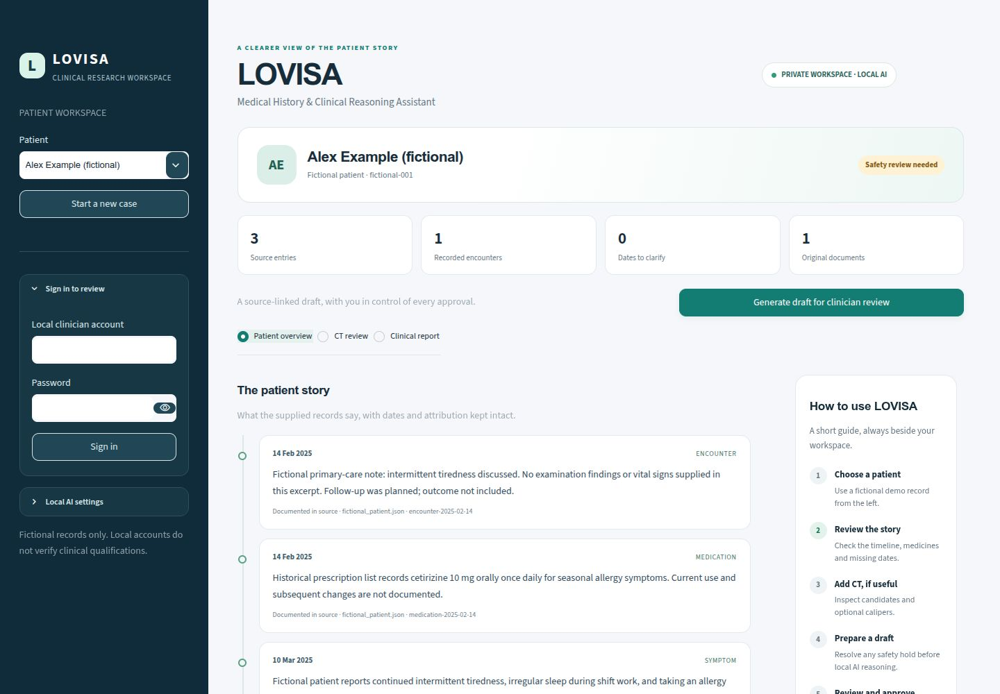
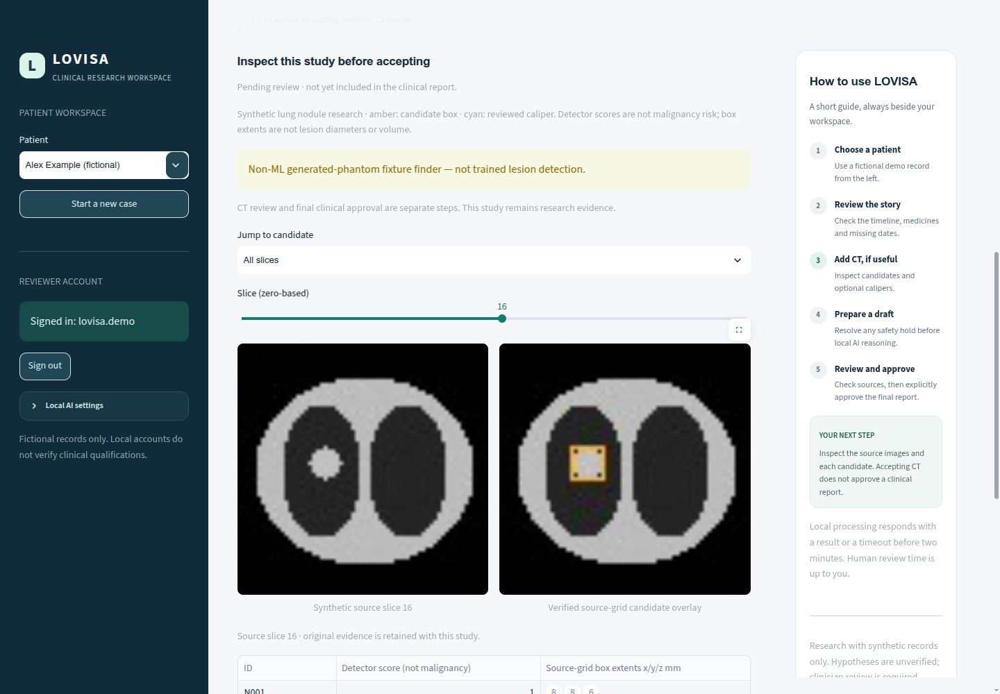

# LOVISA workspace

[Overview](../README.md) · [First case](WORKFLOWS.md) · [Response budgets](PERFORMANCE.md)

## Three focused views

| View | Use it for |
| --- | --- |
| Patient overview | Read dated/undated source cards, attribution and medication history; open originals when needed |
| CT review | Generate or upload a synthetic study, inspect source/annotation slices and review candidates/calipers |
| Clinical report | Handle the safety pause, read the draft and explicitly approve or request corrections |

Select a fictional patient in the left sidebar. The patient header shows actual
source counts and the Python safety-policy state. The right-hand **How to use
LOVISA** guide lists five steps and the next action. On narrow screens the guide
stacks below the workspace and the sidebar can be opened with the native control.

**Generate draft for clinician review** starts background work immediately.
Progress shows real workflow stages, elapsed time and cancellation. CT completion
opens its pending inspection automatically; it never accepts the study for you.
Pending imports/CT must be resolved before a draft. Start a new case to change an
active snapshot. Sign-in is needed for approvals, not initial history inspection.

Raw JSON, hashes, connection settings and original sources are available in
labeled expanders. Missing structured orders stay missing; narrative medication
quotes are displayed without inventing doses. Dates, attribution and source IDs
remain visible in the readable view.

## Local design system

`medical_assistant/ui/theme.css` defines shared ink, muted text, teal, navy,
borders, cards and responsive layout. `components.py` renders escaped timeline,
medication, status, metric, empty-state and guide components. `clinical.py` owns
clinical actions and `history.py` owns approved import forms. `app.py` selects
and lazily renders one view. Imaging-specific components remain in the imaging
modules. Native Streamlit forms, buttons and radios retain keyboard interaction.
No frontend build service, external template CDN or remote font is needed.

The screenshot shows supplied fictional data. Its safety-review state is not a
clinical conclusion. Existing workflow/architecture pictures remain in the
[illustration guide](ILLUSTRATIONS.md).

## Native local connections

SQLite supplies history; Ollama supplies constrained reasoning; the separate CT
Python environment supplies image candidates. There is no cloud inference,
automatic clinical approval, public deployment or custom domain in this version.
The server remains on [localhost:8501](http://127.0.0.1:8501).

This generated fixture remains unapproved. The amber box is a non-ML demonstration
candidate; it is not evidence of lesion-detection accuracy.
