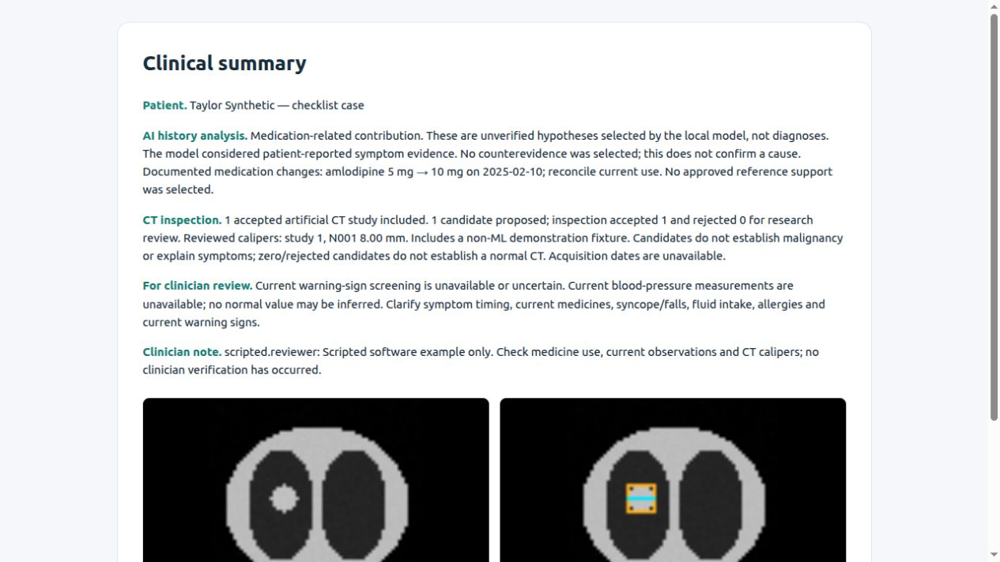

# A concise clinical summary with CT inspection

[Overview](../README.md) · [Operation](WORKFLOWS.md) · [Scripted example](examples/README.md)

The report uses one heading, **Clinical summary**, with short labelled paragraphs.
It does not repeat the full timeline or print filenames, entry IDs and hashes.

| Content | Where it comes from |
| --- | --- |
| AI history analysis | Hypotheses/evidence IDs selected by local Ollama from the existing limited catalog; Python validates and presents them |
| CT inspection | Accepted study snapshots, candidate decisions and reviewer-placed calipers, validated in Python |
| Essential gaps | Versioned safety assessment and source-bound missing information |
| Clinician note | An authenticated reviewer comment, previewed before approval; up to 600 characters |
| Representative pictures | Verified source CT and annotations, including reviewed calipers |

The LLM analyzes history. It does **not** inspect CT pixels, select imaging decisions
or calculate lesion measurements. Combining the results in one report does not
establish a diagnosis, malignancy risk or a cause for the symptoms.

This illustration uses authored artificial pixels, scripted model output and a
scripted reviewer. It demonstrates the software format, not live clinical review
or diagnostic accuracy. [Open its self-contained HTML](examples/clinical-summary.html)
· [Read the text version](examples/clinical-summary.md).

## Include CT reliably

Inspect and **accept** the patient's CT before completing safety preparation.
That preparation freezes the accepted studies into the report snapshot. Pending
or discarded studies are never silently treated as accepted results. No CT is a
visible state, not an empty appendix. **Start a new report with CT** opens an
unlocked CT review for the same patient.

If a study is accepted after a report was prepared, start a new review to include
it. Existing reports retain their original snapshot. Clinical report and final
HTML show representative source/annotation images; CT review retains all slices.
For multiple studies, the prose aggregates every accepted study. At most three
representative study pictures and three calipers appear in the short report;
additional details remain in CT review and the evidence package. No missing
measurement, normal CT or cancer conclusion is inferred.

## Note preview and approval

1. Enter a brief clinician note or review feedback.
2. Choose **Preview note in report**. This updates the draft and clears the review
   checkbox; it does not call the LLM or approve anything.
3. Read the updated text and CT images. Tick the review checkbox again, choose
   **Approve report**, and submit the review.

Approval of an older draft cannot approve a changed note. Notes have signed,
case-bound authorship and remain distinct from source facts. New clinical facts
need an approved record import and a new review. Notes are shown as reviewer
comments, not independently verified clinical findings.

## Downloads and evidence

| Download | Contents |
| --- | --- |
| HTML | Short summary, clinician note and embedded CT pictures; opens offline and can be printed |
| Markdown | The same concise text; CT inspection results are included, images are in HTML |
| JSON evidence package | Full original records, exact excerpts/IDs/filenames/dates, model evidence selections, references, CT provenance/decisions and review receipts |

The JSON contains CT references/hashes and decisions; original CT archives and
full volumes remain in the local imaging store. HTML embeds representative
pictures, not the entire CT series.

Every final download requires valid approval and rechecks sources, CT artifacts,
note authorship, evidence links and report content. HTML uses no remote assets or
scripts. **Evidence behind the analysis** is a collapsed, readable view of the
model-selected support and counterevidence; **Source records** retains originals.
Simpler visible citations do not remove the underlying evidence or fail-closed
validation.

The short prose shows up to two documented dose changes; the complete medication
history remains in the record and evidence package. Underlying source text is not
truncated or rewritten. [Implementation](CODE_REFERENCE.md) · [Validation](VALIDATION.md).

## Existing reports

Previously saved reports keep their original format and approval. They are not
rewritten. Start a new review to produce and approve this concise format; an old
approval cannot be transferred to new text or new CT content.

Approval also signs a content manifest covering the source records, model evidence,
CT snapshots and clinician note. Even when two studies produce identical short
text, substituting different images or source metadata invalidates the approval.
